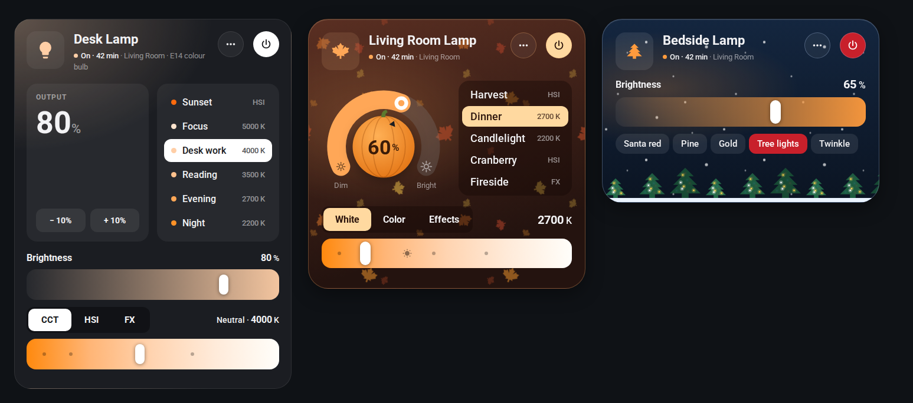
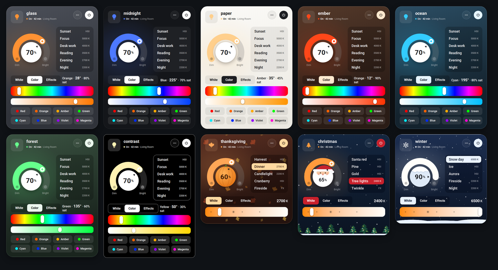
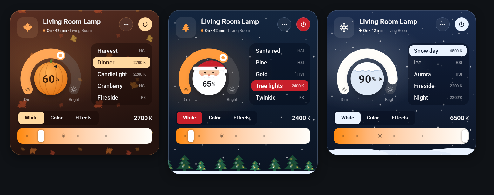

# light-studio-card

Home Assistant dashboard cards with no dependencies: two for one light in `light-studio-card.js`, and a matching one for a media player in `music-dial-card.js`.

- `custom:light-studio-card`: brightness, presets, and warmth / colour / effect tabs that appear only when the light supports them.
- `custom:light-dial-card`: the same controls around a brightness dial, with themes and a compact layout.
- `custom:music-dial-card`: a media player in the dial card's look, with a volume dial around the album art.



The screenshots show the cards running on a pretend lamp outside Home Assistant.

## Install

### Marketplace or HACS

The card is not in the default catalogue, so add this repository yourself:

- Home Assistant 2026.11 and newer: Settings > Marketplace > Add from link, and enter `davidcoulson/light-studio-card`.
- Older versions with HACS: HACS > ⋮ > Custom repositories, and add `https://github.com/davidcoulson/light-studio-card` with type Dashboard.

[](https://my.home-assistant.io/redirect/hacs_repository/?owner=davidcoulson&repository=light-studio-card&category=plugin)

Then install Light Studio Card from the list. The dashboard resource for the light cards is added for you. For the music card, add a second resource yourself, of type JavaScript module, for `music-dial-card.js` in the same folder (the light cards' resource shows the folder, for example `/local/community/light-studio-card/music-dial-card.js`).

### Manual

Copy `light-studio-card.js` to `/config/www/` and add it as a dashboard resource:

```yaml
url: /local/light-studio-card.js
type: module
```

For the music card, do the same with `music-dial-card.js`. It builds on the light file, so it needs both resources.

## Use

```yaml
type: custom:light-studio-card
entity: light.office_lamp
name: Desk Lamp                        # optional
icon: mdi:desk-lamp                    # optional
subtitle: E14 colour bulb              # optional, shown after the area
presets:                               # optional; the defaults fit the light
  - { name: Focus, brightness: 100, kelvin: 5000 }
  - { name: Sunset, brightness: 90, color: [23, 95] }        # hue °, saturation %
  - { name: Candle, brightness: 40, effect: Candle Flicker }
```

A bulb exposed as several lights that are never on together (a white centre and a colour ring) goes in one card with `entities:`. Each tab drives the part that supports it, and moving to another part turns the lit one off.

```yaml
type: custom:light-dial-card
entities: [light.office_center_lights, light.office_accent_lights]
theme: auto        # glass (default) | midnight | paper | ember | ocean | forest | contrast | thanksgiving | christmas | winter | auto
compact: true      # header, brightness slider and preset chips only
```

### Themes

The dial card has seven themes and three seasonal ones. `theme: auto` uses midnight in dark mode and paper in light mode.



Three seasonal themes add moving art behind the controls and dress the dial's centre: `thanksgiving` (falling leaves, a pumpkin), `christmas` (snow over a row of lit trees, Santa) and `winter` (snow, a snow-capped dial). Each card starts its animation at its own random point, so cards side by side don't move in step. The motion stops when the device asks for reduced motion.



Seasonal presets like the ones in the screenshot are set with `presets:`; the themes change only the look.

### Warmth suggestion

On the dial card, the sun marker on the warmth slider shows a suggested warmth for the time of day; tap it to apply.

## Music card

```yaml
type: custom:music-dial-card
entity: media_player.office_speaker
name: Office Speaker                   # optional
icon: mdi:speaker                      # optional
theme: auto                            # optional, the same values as the dial card
favorites:                             # optional buttons that start something playing
  - { name: Jazz, media_content_id: "library://playlist/12", media_content_type: playlist }
  - { name: Focus, media_content_id: "library://playlist/31", media_content_type: playlist }
```

Drag the ring around the album art to set the volume; tap the art for the player's more-info dialog. The dial sits above the track and buttons, and beside them when the card is 520px wide or more, so it fits a wall panel upright or on its side. Buttons the player does not support (shuffle, repeat, previous, next, power) are left out, and the progress bar shows only when the player reports the track's length. A favourite is highlighted while the player reports its `media_content_id`.

## Test

```bash
node tests/card_test.js
```
